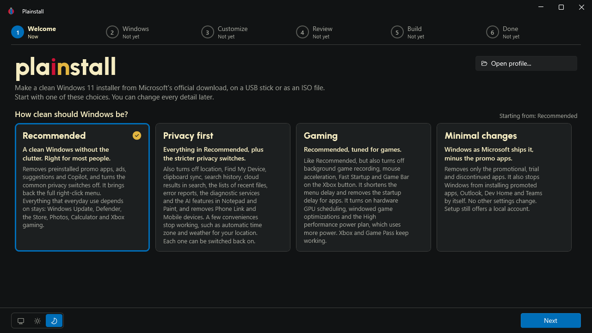
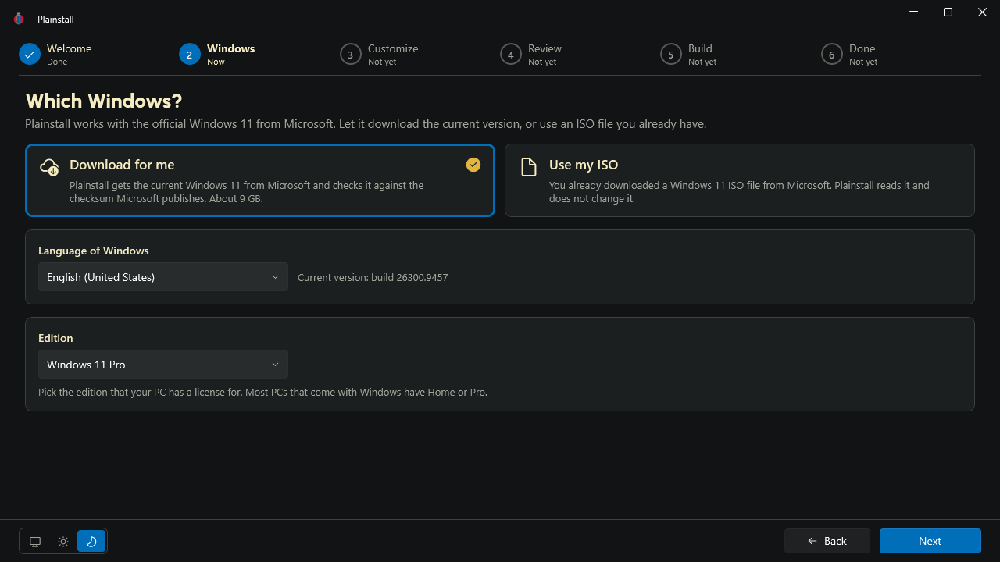
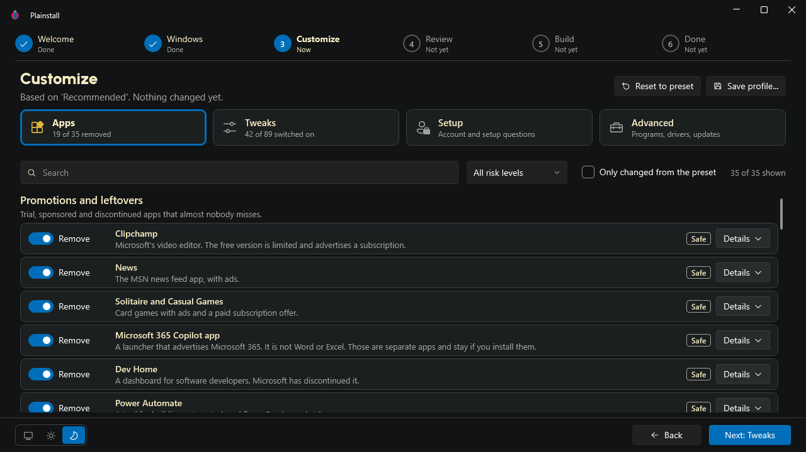
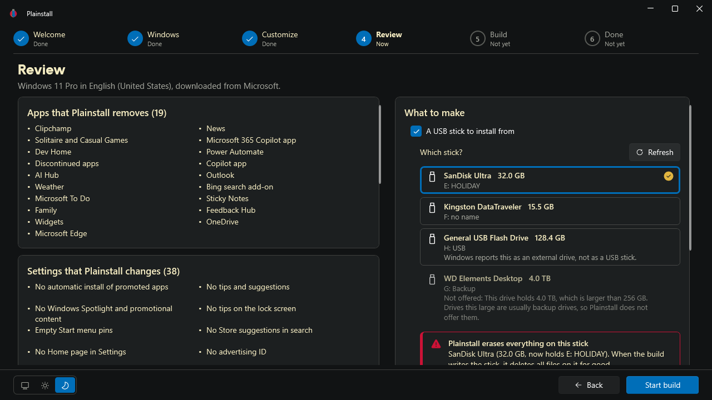
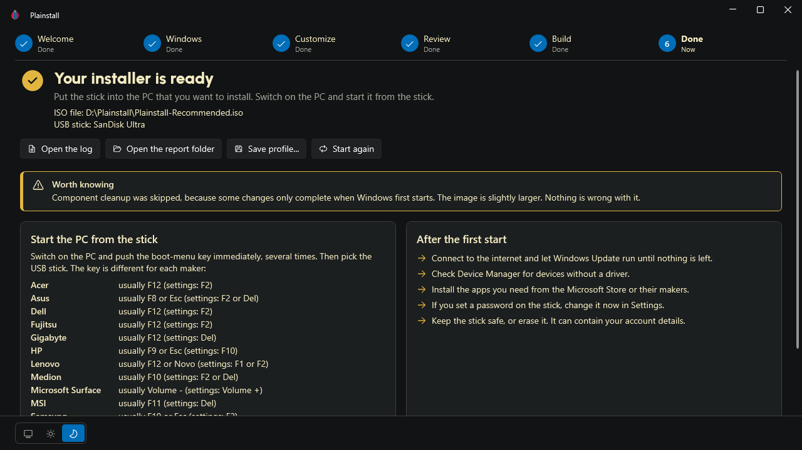

<p align="center">
  
</p>

<h1 align="center">Plainstall</h1>

<p align="center">
  <a href="https://github.com/annoyedmilk/Plainstall/releases/latest">Download</a> ·
  <a href="#how-to-use-plainstall">How to use</a> ·
  <a href="CHANGELOG.md">Changelog</a>
</p>

Plainstall is a free app that makes a clean Windows 11 installer. It downloads Windows 11 from Microsoft and removes the apps and settings that you do not want. Then it writes the installer to a USB stick or to an ISO file.

To use Plainstall, download it, start it, select a preset and follow the steps on the screen.



Plainstall is an independent open-source project. Microsoft does not make, support or endorse Plainstall.

## Download

1. Open the [latest release](https://github.com/annoyedmilk/Plainstall/releases/latest).
2. Download `Plainstall-<version>-win-x64.exe`.
3. Start the file. Windows asks for administrator rights. Select **Yes**.

Plainstall is one file. You do not install it, and you do not need .NET.

> [!NOTE]
> The file is not signed yet. Windows SmartScreen can show the message "Windows protected your PC". Select **More info**, then **Run anyway**.
>
> To make sure that the file is correct, compare its checksum with `SHA256SUMS.txt` on the release page. In PowerShell, use `Get-FileHash .\Plainstall-<version>-win-x64.exe`.

## How to use Plainstall

### 1. Select a preset

The first page shows four presets: Recommended, Privacy first, Gaming and Minimal changes. A preset is only a start point. You can change each item later.

You can also open a profile that you saved before.

### 2. Select Windows

Plainstall downloads Windows 11 from Microsoft. It compares the file with the checksum that Microsoft publishes. If you already have a Windows 11 ISO file, you can use it instead. Select the language and the edition.



### 3. Customize

Select the apps to remove and the settings to change. Each item has a short explanation, a risk level and a **Details** button.

The page has four sections. Select a section card at the top to open it. **Next** also opens the sections in sequence. The text on the button shows the name of the next section.

- **Apps**: the preinstalled apps that Plainstall removes.
- **Tweaks**: the Windows settings that Plainstall changes, for example privacy, ads, Start menu and taskbar.
- **Setup**: the local account, the computer name, the region, the keyboard and the time zone.
- **Advanced**: apps to install with winget at the first sign-in, drivers, Windows updates and a check of the finished image for damage.



### 4. Review and start

Plainstall shows all changes in a summary. Select a USB stick, an ISO file or both. The page also shows how much disk space and time the build needs. Then select **Start build**.

> [!WARNING]
> Plainstall erases all data on the USB stick that you select.



### 5. Install Windows

When the build is done, Plainstall shows where the files are. It also shows the keys that open the boot menu on many PCs.

1. Put the USB stick into the PC.
2. Start the PC from the USB stick.
3. Windows Setup asks for the disk. Windows Setup erases the disk that you select.
4. Windows Setup installs Windows with your selections.



## What stays on the PC

These parts of Windows always stay and continue to work:

- Windows Update
- Microsoft Defender
- Microsoft Store
- Windows Terminal
- winget, the app installer

You can install a removed app again from the Microsoft Store or from its maker.

## What you need

- A PC with an Intel or AMD processor (x64). Plainstall does not work on PCs with an ARM processor.
- Administrator rights on that PC.
- Approximately 30 GB of free space on a drive with the NTFS file system.
- An internet connection.
- A USB stick of 16 GB to 256 GB.

## Profiles

You can save your selections as a profile, a file that ends with `.plainstall.json`. Then you can use the same selections on a different PC or for a newer version of Windows. The profile does not contain the password.

## Command-line tool

`Plainstall.Cli-<version>-win-x64.exe` does the same work as the app, but without a window. You can use it in scripts. Start the terminal as administrator. In these examples, the file has the name `Plainstall.Cli.exe`:

```powershell
.\Plainstall.Cli.exe profile new --preset recommended --out my.plainstall.json
.\Plainstall.Cli.exe build --profile my.plainstall.json --iso C:\Plainstall\Windows11.iso
```

To see all commands, use `.\Plainstall.Cli.exe --help`.

## Clean up

A build can stop before it is done, for example after a power failure. Then Plainstall can leave files and a mounted Windows image on the PC. To remove them, select **Clean up** on the first page of the app, or use `.\Plainstall.Cli.exe cleanup`.

Plainstall keeps the downloaded Windows files, tools and logs in `C:\ProgramData\Plainstall`, so the next build is faster. To delete these files, select **Delete these files** at the bottom of the first page, or use `.\Plainstall.Cli.exe cleanup --all`. Plainstall does not delete files while a build runs. The app keeps its settings and its own log in `%LOCALAPPDATA%\Plainstall`. These small files stay.

## Privacy

Plainstall does not collect data about you or your PC. It connects only to Microsoft, to download Windows and the ISO tool oscdimg, and to GitHub, to look for a new version of Plainstall.

## Credits

Plainstall uses what these projects found:

- [ntdevlabs/tiny11builder](https://github.com/ntdevlabs/tiny11builder): the origin of the method.
- [Raphire/Win11Debloat](https://github.com/Raphire/Win11Debloat): many privacy and cleanup settings.
- [ChrisTitusTech/winutil](https://github.com/ChrisTitusTech/winutil): many lessons about Windows Setup.

## License

[MIT](LICENSE)
